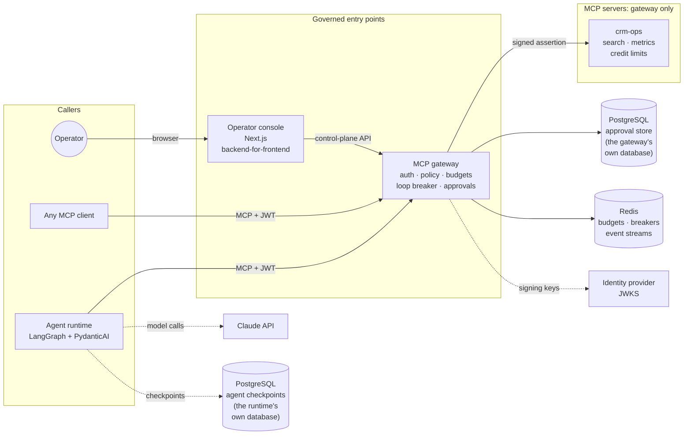
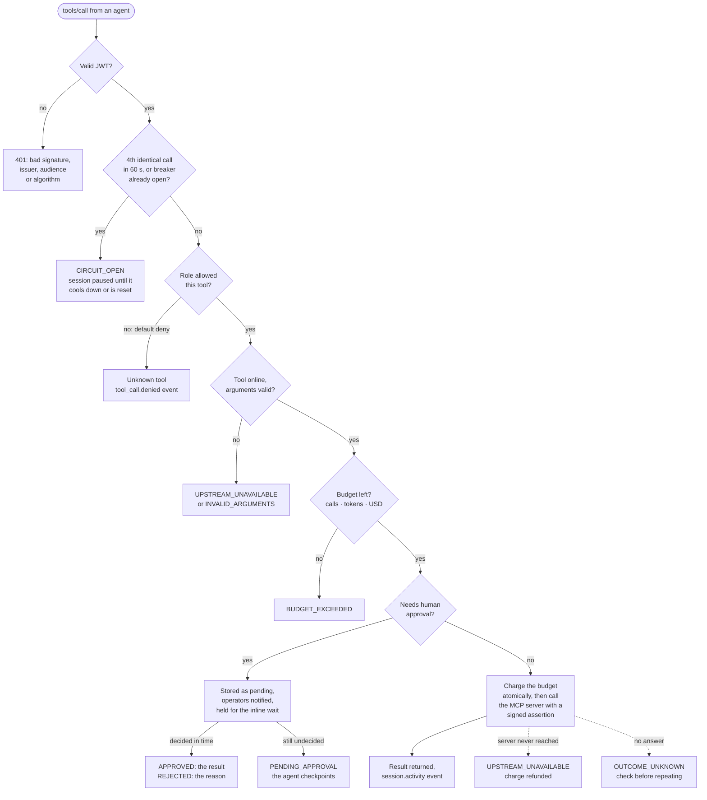
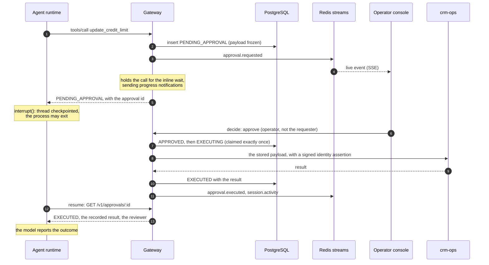
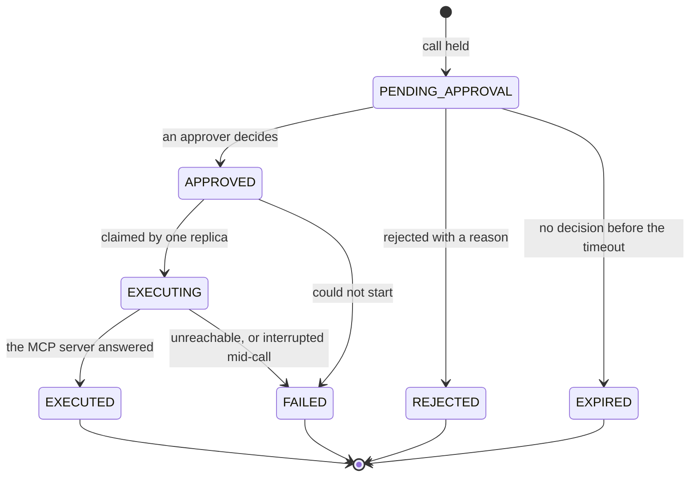
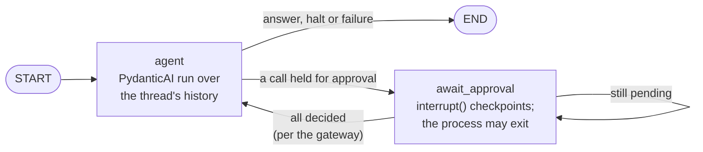
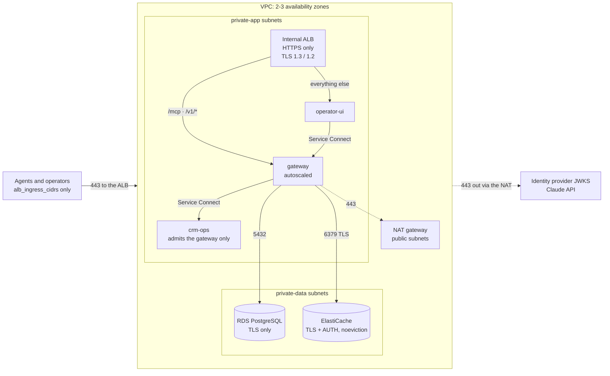

# MCP Enterprise Gateway & Governed Agent Runtime

A policy enforcement point between autonomous AI agents and internal Model Context
Protocol (MCP) servers. Agents connect to the gateway and nowhere else. The gateway:
- authenticates them (JWT);
- authorises every tool call against a declarative policy (RBAC);
- enforces per-session budgets and loop detection (Redis);
- suspends high-consequence calls for human approval (PostgreSQL);
- traces all of it (OpenTelemetry).

An agent runtime (LangGraph + PydanticAI, Claude) works through the gateway, pausing
durably while humans decide. An operator console shows the approval queue, live spend
and alerts. Terraform deploys the whole system to AWS as private Fargate services behind
an internal load balancer, with no hardcoded secrets.

> **Status: complete (Phases 1-4).** Every component is built and tested: unit,
> integration against real PostgreSQL and Redis, live Claude runs, and plan-time tests of
> every Terraform module. See the [build plan](#build-plan).

## Architecture



| Component | Role |
| --- | --- |
| `gateway/` | FastAPI + the official MCP SDK. The single entry point for agents (`/mcp`) and the control plane (`/v1/*`): approvals, sessions, events (SSE), usage reports. |
| `mcp-servers/crm-ops/` | A sample MCP server with three CRM tools. It trusts only short-lived identity assertions signed by the gateway, and scopes every lookup to the asserted tenant. |
| `agent-runtime/` | A LangGraph graph around a PydanticAI agent (Claude Opus 5.5). It turns the gateway's verdicts into control flow, and checkpoints in PostgreSQL while a human decides. |
| `operator-ui/` | Next.js 15 console: live traffic through the gateway, the approval queue with each call's exact payload, session spend against caps, alerts, events and the enforced policy. Operator tokens never reach the browser. |
| `infra/terraform/` | VPC, ECS Fargate, RDS PostgreSQL, ElastiCache, Secrets Manager. |

## How a tool call is governed

Every `tools/call` passes the same checks in this order, and each refusal comes back as a
structured verdict (`_meta["mcp-enterprise-gateway/governance"]`) that agents act on:



Loop detection runs before authorisation on purpose: hammering a forbidden tool trips the
breaker too.

## Human in the loop, end to end



The database itself enforces the approval state machine with a trigger, keeps the
payload immutable, and makes the audit trail append-only:



A background sweeper keeps this honest across crashes:
- An approved call that no replica started is executed.
- A call interrupted mid-flight is marked `FAILED` with an unknown outcome, and is never
  re-run blindly.

## Repository layout

```
mcp-enterprise-gateway/
├── config/policies.yaml         governance policy (+ generated policies.schema.json)
├── gateway/                     FastAPI + MCP SDK: auth, RBAC, budgets, breaker, HITL, API
├── mcp-servers/crm-ops/         sample MCP server (MCPServer): 3 CRM tools, tenant-scoped
├── libs/platform-telemetry/     shared OpenTelemetry bootstrap
├── agent-runtime/               LangGraph + PydanticAI agent; CLI; Postgres checkpoints
├── operator-ui/                 Next.js 15 operator console (backend-for-frontend)
├── infra/local/                 compose support: OTel Collector, Prometheus, Postgres init
├── infra/terraform/             AWS: 5 modules, the dev environment, plan-time tests
├── docker-compose.yml           the whole stack, plus the agent runtime as a job (profile "agent")
└── Makefile                     `make` lists every target
```

## Quick start

Requires Docker with Compose v2, [uv](https://docs.astral.sh/uv/) >= 0.9, GNU Make, and
for the console's checks Node.js >= 20.18 with pnpm 9 (`corepack enable`).

```bash
make env         # .env with generated secrets (git-ignored, mode 600)
                 # then set ANTHROPIC_API_KEY in .env to run the agent
make up          # build and start the whole stack; waits until it is healthy
make sync        # Python workspace (CPython 3.12)
make ui-install  # console dependencies (pnpm, frozen lockfile)
make verify      # compose config, policy, lint, mypy --strict, all tests, console, terraform
```

| Service | Address (127.0.0.1 only) |
| --- | --- |
| Operator console | http://localhost:3000 |
| Gateway: MCP endpoint / API docs | http://localhost:8000/mcp, http://localhost:8000/docs |
| Jaeger / Prometheus | http://localhost:16686, http://localhost:9090 |
| PostgreSQL / Redis | localhost:15432, localhost:16379 |

crm-ops publishes no port: it is reachable from the gateway only.

## Try it

1. **Give the agent a task that needs a human decision.**

   ```bash
   make agent-run PROMPT='Check the receivables of Alder Freight and request raising its credit limit to $600,000 for the Q4 peak.'
   ```

   The agent (Claude Opus 5.5) searches the CRM and reads the account's metrics, then
   asks for the change. The gateway holds that call. The thread is checkpointed in
   PostgreSQL and the command exits with code 2 and the thread id. Nothing has changed
   in the CRM.
2. **Decide.** Open http://localhost:3000 and use *Development sign-in* as an
   `operator`. The held call waits under *Approvals* with its exact arguments, the
   agent's reasoning and a countdown to expiry. Approving a high-risk call takes a
   press-and-hold, and the gateway then runs the stored payload; *Reject* needs a reason.
3. **Resume.** `make agent-resume THREAD=t-...` starts a fresh container, loads the
   thread from its checkpoint and asks the gateway for the outcome. The agent then
   reports what happened, including a rejection and its reason. A resume before the
   decision changes nothing.

Without the agent, any MCP client can talk to `http://localhost:8000/mcp` with a token
from `make -s token ROLE=admin`:
- `analyst` sees only the two read tools;
- the fourth identical call within 60 s trips the session's circuit breaker, and the
  console offers *Reset*.

To watch the console under load without calling a model, run `make demo-traffic`
(`DURATION=180` for longer). Four `demo-` agents make real calls through the gateway:
- reads, with reported (not generated) model usage;
- one denied write;
- one credit-limit change held for approval;
- one loop that trips its breaker.

Nothing is billed. The held demo call expires unexecuted unless someone decides it.

## The policy

`config/policies.yaml` is the single source of truth for governance (`make policy-matrix`):

```
tool                          access  risk  analyst  admin  operator  auditor
crm-ops__search_accounts      read    low   ALLOW    ALLOW  -         -
crm-ops__get_account_metrics  read    low   ALLOW    ALLOW  -         -
crm-ops__update_credit_limit  write   high  -        HITL   -         -
```

The loader rejects the whole file, and the gateway will not start, if any invariant is
broken:
- **Closed world:** unknown keys and duplicate YAML keys are errors.
- **Strict types:** nothing is coerced, and money is exact `Decimal`.
- **Default deny:** only registered tools exist for agents.
- **Deny wins:** `deny` beats `allow`, even through inheritance.
- **Checked references:** grant patterns and approver roles must resolve.
- **Segregation of duties:** a role that can call an approval-gated tool can never
  approve it.
- **Timing and pricing:** approval timings must be consistent, and fallback pricing
  conservative.

## The agent runtime

`agent-runtime/` is a LangGraph graph around a PydanticAI agent. Its only route to tools
is the gateway's MCP endpoint, under a per-thread token whose `sid` is the thread id, so
the gateway budgets, rate-limits and audits each thread as one session.



The toolset turns each gateway verdict into agent control flow:

| Gateway result | Agent behaviour |
| --- | --- |
| tool result, or `APPROVED` inline | returned to the model |
| `PENDING_APPROVAL` | `CallDeferred`: the run ends with `DeferredToolRequests`; the graph checkpoints and interrupts |
| `INVALID_ARGUMENTS` | `ModelRetry`: the model fixes its arguments |
| `BUDGET_EXCEEDED`, `CIRCUIT_OPEN` | the thread halts; `agent-runtime retry` continues it after an operator acts |
| `REJECTED`, `EXPIRED`, `APPROVAL_FAILED`, `UPSTREAM_UNAVAILABLE`, `OUTCOME_UNKNOWN`, policy denial | `ToolFailed`: the model must report it and must not repeat the call |

- **Decisions come from the gateway.** On resume, the graph asks the gateway for each
  approval. Whatever value a client passes to `Command(resume=...)` is ignored. An
  executed call returns the upstream result the gateway recorded, with the reviewer's
  name.
- **Spend is reported per response, and the runtime fails closed.** Each model response's
  tokens go to `POST /v1/sessions/{sid}/usage`. That includes 5-minute and 1-hour cache
  writes, and it names the model that actually answered. If the gateway does not accept
  the report, the run stops.
- **Model:** `claude-opus-5-5` with adaptive thinking at `medium` effort, streaming,
  automatic prompt caching, and **server-side fallbacks** (`fallbacks: "default"`, beta
  `server-side-fallback-2026-07-01`). A request that a safety classifier declines is
  re-run on Anthropic's recommended fallback model instead of failing. Turn this off
  with `AGENT_SERVER_SIDE_FALLBACKS=false`.
- **Stopped runs keep their work.** A run that halts or fails keeps its history up to the
  last consistent point, so a retry does not redo or re-pay for completed steps.

CLI: `agent-runtime run|resume|status|retry`, with `--wait` to follow decisions. Exit
codes: 0 completed, 2 awaiting approval, 3 halted, 1 failed. Settings are `AGENT_*`
variables; see `agent-runtime/README.md`. A typical governed task (three tool calls and
four model requests) costs about $0.03 in model usage.

## The operator console

`operator-ui/` has five views behind one live connection:

| View | What it is for |
| --- | --- |
| Overview | The live traffic gate, key figures with sparklines, held calls, alerts, busiest sessions |
| Approvals | Held and decided calls: the change, the agent's reasoning, the payload, the audit trail |
| Sessions | Spend, tokens and calls against each session's caps; breaker state and reset |
| Activity | Every event of the last 15 minutes, then live, with a histogram and filters |
| Policy | The enforced role × tool matrix, upstream health and each role's console actions |

The live traffic gate draws every real tool call: an allowed call passes the gateway to
its server, a denied call bounces off, and a held call waits at the gate until someone
decides it. Nothing on it is simulated. Motion follows the OS *reduce motion* setting.
The console has light and dark themes and a ⌘K command palette.

It is a backend-for-frontend. The browser talks only to the console. Its route handlers
call the gateway with the operator's token, which is kept in an encrypted (A256GCM),
httpOnly, SameSite=Strict cookie and never reaches page scripts.
- **Requests:** state-changing calls also pass a same-origin check. Route parameters are
  validated before they become gateway URLs.
- **Live updates:** the gateway's event stream is relayed as SSE. A fresh console replays
  the last 15 minutes, then streams live; a reconnect resumes with `Last-Event-ID`.
- **Permissions:** what a role may do (decide, reset breakers) comes from the gateway's
  policy at sign-in, and the gateway re-checks every request.
- **Sign-in:** locally, *Development sign-in* mints a short-lived token with the gateway's
  development secret. Deployed consoles set `DEV_SIGNIN=false` and accept identity
  provider tokens.

## Deploying to AWS

`infra/terraform/environments/dev` deploys the system with five modules:
- `vpc`
- `secrets_manager`
- `rds_postgres`
- `elasticache_redis`
- `ecs_fargate`

Nothing listens on a public address.



- **One way in.** The internal ALB exposes only the gateway and the console, and only on
  HTTPS.
- **MCP servers are east-west only.** They are reached over ECS Service Connect, and each
  admits only the gateway's security group. Every workload has its own security group,
  with least-privilege egress.
- **No route out from the data tier.** RDS and ElastiCache sit in subnets with local
  routes only, and admit only the security groups of the workloads that use them.
- **On-demand tasks.** `db-bootstrap` creates the service roles and databases.
  `agent-runtime` reaches the gateway through the ALB like any other agent, and keeps its
  checkpoints in its own database.
- **Zero hardcoded secrets.** Generated secrets are written with write-only arguments, so
  they appear in neither plans nor state. ElastiCache reads its AUTH token back
  ephemerally. RDS manages and rotates its own master credential, and only the one-off
  `db-bootstrap` task can read it.
- **Hardened containers.** They use read-only root filesystems, images pinned by digest,
  and no shell access (ECS Exec off). Each execution role can read only that workload's
  own secrets.

`infra/terraform/README.md` has the deployment runbook. `make tf-test` checks all of this
without an AWS account: plan-time tests run every module against mocked providers.

## Guardrail tests

| Command | What runs |
| --- | --- |
| `make test` | 242 Python tests in about 50 s, including 52 integration tests against real PostgreSQL and Redis (`make up`), real gateway and crm-ops servers, and the official MCP client |
| `make ui-check` | the console's ESLint, TypeScript and 54 unit tests |
| `make tf-test` | 33 Terraform tests across the five modules and the dev environment, with mocked AWS (no account, no cost) |
| `make test-live` | the pause, approve and resume flow with real Claude; prints its cost (opt-in) |

| Suite | Proves |
| --- | --- |
| `test_rbac.py` | (a) unauthorised tools are denied before anything reaches upstream; tools/list filtered per role; tenant isolation; bad tokens (expired, forged, `alg=none`, wrong audience) rejected |
| `test_circuit_breaker.py` | (b) the 4th identical call in 60 s trips the session breaker; per-session; denied-tool hammering trips too; operator-only reset; signed webhook |
| `test_hitl.py` | (c) pause -> approve -> resume inline; checkpoint + resume after the inline wait; reject; de-duplication (executed once); four-eyes and tenant guards; decide-only approvers; expiry; crash recovery (an approved call a dead replica never started runs; an interrupted one fails, never re-runs); database-enforced invariants |
| `test_budgets.py` | tool-call and USD caps; exact pricing per token type and cache TTL; conservative fallback; metered tools; unpriced model ids never become metric labels |
| `test_failure_handling.py` | event hub: fan-out, paged resume without gaps, slow-subscriber drop; refunds floor at zero; an unreachable upstream is reported and refunded |
| `test_events_and_tracing.py` | SSE with `Last-Event-ID` resume; one trace spanning agent -> gateway -> crm-ops |
| `agent-runtime/.../test_hitl_flow.py` | (c) for the agent: a held call pauses the thread; a **second process** resumes it from PostgreSQL after approval; rejections reach the model; forged resume payloads are ignored; inline approvals need no pause; an exhausted budget halts the thread |
| `infra/terraform/**/tests` | only the gateway and console face clients; crm-ops admits the gateway alone; tasks accept no traffic; each workload reads only its own secrets; no secret value in state; the data tier has no route out; TLS-only database and cache; `noeviction` |

## Supply chain

- `make audit` runs pip-audit over the exact locked dependency set. Two advisories with
  no fixed release are accepted, and the Makefile says why: python-jose's DER-key HMAC
  confusion (PYSEC-2026-4298) and ecdsa's signing timing leak (PYSEC-2026-1325). Neither
  is reachable here, and regression tests pin both mitigations: the algorithm allow-list
  is checked before any key is chosen, and jose runs on its `cryptography` backends.
- The Terraform scans clean with Trivy at every severity. It has two justified, in-code
  exceptions: plain HTTP in the explicit sandbox mode, and HTTPS egress to the internet
  for the identity provider and model APIs.

## Design decisions

| Decision | Why |
| --- | --- |
| The policy's tool registry is authoritative; upstream MCP annotations are advisory | A careless or compromised MCP server cannot reclassify its own write tool as read-only. |
| HITL: bounded inline wait, then `PENDING_APPROVAL` + agent checkpoint | Approvals take minutes; holding HTTP requests that long breaks behind load balancers. |
| The gateway executes the approved payload itself, once | The stored request is immutable, so arguments cannot change between review and execution. |
| Agents report model usage to the gateway (`POST /v1/sessions/{sid}/usage`) | The gateway prices it and enforces the cap on every tool call. LLM-side enforcement relies on the agent runtime reporting faithfully; routing model calls through the gateway would make it authoritative. |
| Stateless MCP transport on both hops | Any replica serves any request; no session affinity behind the ALB. |
| Upstreams receive signed, short-lived identity assertions, never agent tokens | MCP servers trust the gateway's authorisation and can scope data to the asserted tenant. |
| Redis Lua scripts for every check-and-update; server time; `noeviction` | Atomic across replicas; an evicted key cannot silently reset a budget. |
| Events on Redis Streams | SSE clients resume with `Last-Event-ID`, and waiters cannot miss a decision. |
| Separate Postgres database and role per service | The agent runtime can never write to the approvals table, and in compose it cannot even reach Redis. |
| Approved calls survive a crashed replica | A sweeper runs approved calls that no replica started. A call interrupted mid-flight is marked failed with an unknown outcome and is never re-run blindly. |
| Refund only what provably never ran | A call refused before it reached the upstream is refunded. After a timeout the outcome is unknown, so the agent is told to check before repeating it. |
| The console is a backend-for-frontend | Operator tokens stay server-side, the gateway needs no CORS, and an XSS bug could not steal a token. |
| Service roles are created by a one-off task, not Terraform | No database provider (and no database credential) in the Terraform pipeline; the task is idempotent and doubles as password rotation. |
| No default credentials anywhere | Compose refuses to start without generated secrets; in AWS the IdP's JWKS, RDS-managed credentials and write-only secrets replace them. |

## Build plan

| Phase | Scope | Status |
| --- | --- | --- |
| 1 | Repo structure, compose stack, policy schema + engine, Terraform interfaces | done |
| 2 | crm-ops MCP server; gateway: JWT RBAC, Redis budget/loop middleware, HITL state machine; guardrail tests | done |
| 3 | agent-runtime (LangGraph + PydanticAI), operator-ui (Next.js); Phase 1-2 review fixes | done |
| 4 | Terraform module implementations with plan-time tests; README with Mermaid diagrams | done |
